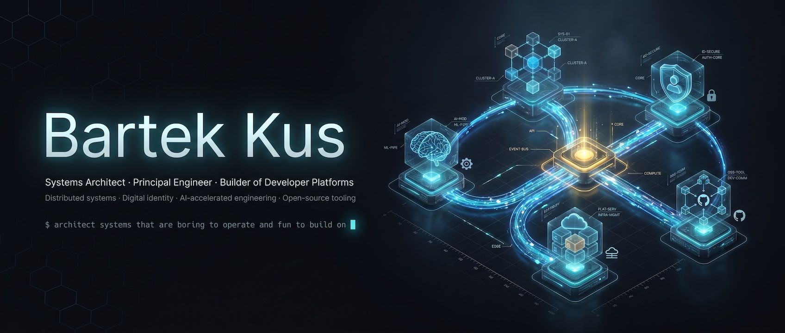

  

## 👋 Howdy, I'm Bartek

 

I'm **Bartek Kus**, a systems architect from Edmonton, Canada. I work on the trust problem in AI-native software delivery:

> **AI can write the code. The unsolved problem is trusting what it wrote.**

My answer is **architecting intent**: the human authors the contract, agents do the work, and machinery (not optimism) refuses anything that drifts from the contract. Stop reviewing output; start constraining intent.

---

### 🔭 What I'm building

Everything lives under the **[statecrafting](https://github.com/statecrafting)** org; the public record is **[statecraft.ing](https://statecraft.ing)**, a static catalog of every specification in the family, pinned to immutable source revisions. The family is small tools with explicit boundaries, all Rust, all Apache-2.0. Each repository owns its own specs, and a library capability, a release and a deployed service are reported as separate claims.

**[spec-spine](https://github.com/statecrafting/spec-spine)**: a typed, hash-verifiable authority ledger over a markdown spec corpus. Every spec declares the files, sections and symbols it owns; a PR-time coupling gate refuses code that drifts from its owning spec. Byte-identical output across platforms, one exit-code contract, `--json` everywhere. Released: v0.32.0 on [crates.io](https://crates.io/crates/spec-spine-cli), [npm](https://www.npmjs.com/package/spec-spine) and [PyPI](https://pypi.org/project/spec-spine/). It governs itself: its own coupling gate runs against its own spec corpus in CI.

**[statecraft-cli](https://github.com/statecrafting/statecraft-cli)**: a local environment for governed agent work. Register a repository, prepare an isolated workspace, supervise an agent through one unit of work, judge the result independently, keep a reviewable account. One machine, one repo, no account. Specified, implemented and tested; publication is deliberately deferred, so it runs from a checkout.

| Project | What it is | State |
|---|---|---|
| **[rahi](https://github.com/statecrafting/rahi)** | The Rust chassis for governed cells: co-deployed [rauthy](https://github.com/sebadob/rauthy) identity, in-process [hiqlite](https://github.com/sebadob/hiqlite) Raft state, a hash-chained decision ledger, a deny-by-default capability kernel, an axum edge, single-container packaging with backup and restore. Apps compose it; they never fork it. | 0.7.1 release candidate on crates.io; supported topology N=1 |
| **[aicortex](https://github.com/statecrafting/aicortex)** | Persistent, governed memory for AI clients over MCP, built as a rahi cell. Recalled content is always data; only a human-recorded promotion makes a memory instruction grade. | Specified; being built one spec per pull request |
| **[rustev](https://github.com/statecrafting/rustev)** | An embeddable engine for making, evaluating and recording decisions over partially trusted information: bounded plans, explicit abstention, an evidence record per decision. Proposals, never grants. | v0.5.0 on crates.io |
| **[wire-witness](https://github.com/statecrafting/wire-witness)** | Captures provider wire exchanges and produces attributed observations with custody facts. Testimony that never grants authority. | v0.1.0 tagged |
| **[action-gate](https://github.com/statecrafting/action-gate) · [attest-ledger](https://github.com/statecrafting/attest-ledger) · [canonical-keysort-json](https://github.com/statecrafting/canonical-keysort-json)** | The primitives: a deterministic Allow/Deny/Degrade gate over a check registry, a tamper-evident Ed25519-signed ledger with an independent verifier, and canonical JSON bytes at the hashing boundary. | 0.3.0 · 0.2.0 · 0.1.1 on crates.io |

### 🤝 Open source I contribute to

- **[rauthy](https://github.com/sebadob/rauthy)** ([@sebadob](https://github.com/sebadob)): a Rust OpenID Connect / OAuth2 / PAM identity provider with passkey-first security; the identity provider every rahi cell co-deploys.
- **[hiqlite](https://github.com/sebadob/hiqlite)** ([@sebadob](https://github.com/sebadob)): an embeddable SQLite that forms a Raft cluster for high availability and strong consistency; the replicated store inside every rahi cell.

---

### 🧭 What I think

- **Architecting intent over vibe coding.** No human reviews every line an agent produces; pretending otherwise just moves the bottleneck back to the human. Make intent the requirement, the requirement a spec, and the spec law.
- **Agentic output is hostile by default.** Agents earn passage by surviving gates, not by appealing to trust. A PR branch is a stranger's bytes until it is checked.
- **Humans gate contracts, not diffs.** Specs, approvals and irreversible boundaries are human territory; everything between them is enforced by machinery.
- **A claim carries its grade.** Specified, implemented, tested, released and deployed are different statements. A tool that cannot tell you which one it is making is not finished.
- **Small tools, explicit boundaries.** A gate does not log, a ledger does not decide, a witness does not authorize, a memory does not instruct. Each refuses the neighbouring job on purpose.

How I got here is one problem at three scales: a decade of digital identity (OIDC, SSI, DID) asking "can this person be trusted", platform engineering asking "can this system be trusted", and now governed agent delivery asking "can machine-generated change be trusted".

---

### 🛠 Tech I reach for often

`Rust` • `TypeScript` • `React` • `SQLite / hiqlite` • `PostgreSQL` •
`Kubernetes` • `Helm` • `Flux` • `Terraform` • `OpenTelemetry` • `Claude Code` • `Codex` • `MCP`

---

### 📊 GitHub at a glance

  
  

---

### 📫 Reach me

➡️ **https://bartekus.com**
➡️ **LinkedIn:** /in/bartekus
➡️ **Twitter:** @bartekus
➡️ **Email:** bart@statecraft.ing

---

> _"The human authors the law; the agents comply with it; the spine makes non-compliance impossible to merge."_
